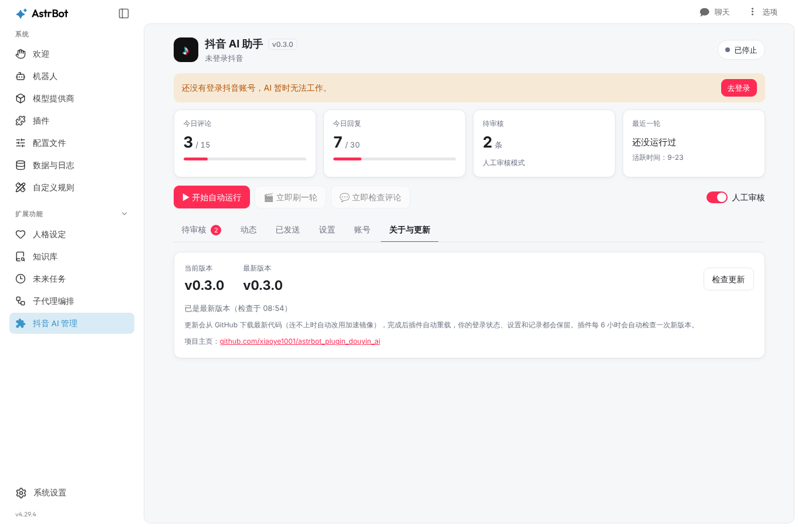

<div align="center">


# 抖音 AI 助手

**AstrBot 插件：让 AI 自己刷抖音、发评论、回复评论**

[](https://github.com/xiaoye1001/astrbot_plugin_douyin_ai/actions/workflows/ci.yml)
[](https://github.com/xiaoye1001/astrbot_plugin_douyin_ai/releases)
[](https://github.com/AstrBotDevs/AstrBot)
[](LICENSE)

</div>

## 功能

- 🎬 **自己刷视频**：在推荐页一个个往下刷，每个视频随机停留一会儿
- ✍️ **自己评论**：读视频文案、话题和热门评论，由 AI 按你设定的人设决定评不评、评什么
- 💬 **自己回复评论**：定时检查你最近作品下的新评论，AI 以博主身份回复
- 🛡️ **人工审核（默认开启）**：AI 写好的内容先给你看，确认或修改后才发出
- ⏱️ **防刷屏**：每日上限、两次发言最小间隔、活跃时间段
- 🖥️ **可视化管理页面**：在 AstrBot 管理面板里查看状态、审核内容、修改设置、扫码登录
- 🆕 **一键更新**：自动检查新版本，在页面上点一下就能更新



## 安装

需要 **AstrBot v4.29.0 及以上**。

1. 在 AstrBot 管理面板 → 插件 → 安装插件，填入仓库地址：

   ```text
   https://github.com/xiaoye1001/astrbot_plugin_douyin_ai
   ```

2. 安装完成后，左侧菜单会出现「**抖音 AI 管理**」。
3. 浏览器不用手动装：插件会**直接使用电脑上已有的 Chrome / Edge / Chromium**；没有的话会自动下载：Docker / Debian 下用测速选出的最快国内软件源（阿里云、清华、中科大、华为云）安装，其他系统从国内镜像多线程下载。管理页面会显示下载进度和速度。

<details>
<summary>自动准备浏览器失败怎么办？</summary>

任选一种办法，然后重载插件：

- 在 AstrBot 所在的机器上安装 Chrome 或 Edge 浏览器（Docker 部署可以进入容器执行 `apt-get update && apt-get install -y chromium`）。
- 在插件配置「浏览器可执行文件路径」里填写浏览器路径，例如 `C:\Program Files\Google\Chrome\Application\chrome.exe` 或 `/usr/bin/chromium`。
- 手动执行：

```bash
python -m playwright install --with-deps chromium
```

</details>

## 快速上手

1. 打开「抖音 AI 管理」→「账号」，点「获取登录二维码」，用抖音 App 扫码。
2. 回到「待审核」，点「立即刷一轮」，看看 AI 写的评论效果。
3. 在「设置」里调整人设、频率和每日上限。
4. 满意后点「开始自动运行」。

## 管理页面

| 标签页 | 作用 |
| --- | --- |
| 待审核 | AI 写好的评论和回复，可以直接改文字再发送，或放弃 |
| 动态 | AI 最近做了什么、有没有出错 |
| 已发送 | 已经发出的评论和回复 |
| 设置 | 人设、刷视频 / 回复频率、每日上限、活跃时间段、评论后缀 |
| 账号 | 扫码登录、导入 Cookie、退出登录 |
| 关于与更新 | 当前版本、检查更新、查看更新内容、一键更新 |

模型选择、无头模式、页面选择器等高级选项在 插件 → 抖音 AI 助手 → 配置 里修改。

## 指令

也可以在聊天里用指令操作，所有指令仅 AstrBot 管理员可用。

| 指令 | 作用 |
| --- | --- |
| `/dy login` | 发送登录二维码，用抖音 App 扫码登录 |
| `/dy cookie <cookie>` | 导入电脑浏览器里复制的 Cookie 登录 |
| `/dy bind` | 把审核 / 通知消息发到当前会话（第一次使用任意 `/dy` 指令会自动绑定） |
| `/dy start` / `/dy stop` | 开始 / 停止自动运行 |
| `/dy browse` | 立即刷一轮视频 |
| `/dy reply` | 立即检查一轮作品评论 |
| `/dy pending` | 查看待审核内容 |
| `/dy ok 3` | 发送 #3；`/dy ok 3 新内容` 改完再发 |
| `/dy no 3` / `/dy no all` | 放弃 #3 / 全部放弃 |
| `/dy status` | 查看登录、运行状态和今日计数 |
| `/dy history` | 查看最近发出的内容 |
| `/dy update` | 检查并更新插件 |

## 更新

- 插件每 6 小时自动检查一次新版本，有新版本时管理页面顶部会提示，绑定的会话也会收到消息。
- 在「关于与更新」里点「立即更新」，或发送 `/dy update`。连不上 GitHub 时会自动改用加速镜像。
- 更新后插件自动重载，登录状态、设置和记录都会保留。
- 也可以照常在 AstrBot 的插件页面点「更新」。
- **推荐（可选）**：在 AstrBot「设置 → OpenAPI」创建一个只勾选 `plugin` 权限的 API Key，填到插件配置「AstrBot API Key」。之后一键更新会走 AstrBot 官方公开接口，和插件页面的「更新」按钮流程完全一致（使用插件市场的下载地址）。不填也能一键更新。

每个版本的变化见 [CHANGELOG.md](CHANGELOG.md)。

## 常见问题

**提示「找不到评论输入框」/「找不到回复按钮」**
抖音网页改版了。在插件配置的「页面选择器」里修改对应的选择器（多个用 `||` 分隔，按顺序尝试），或者[提交问题](https://github.com/xiaoye1001/astrbot_plugin_douyin_ai/issues/new/choose)。

**扫码后要求短信验证 / 弹出验证码**
插件不会绕过验证码。可以改用「导入 Cookie」：在电脑浏览器登录抖音网页版，按 F12 → 网络（Network）→ 任意请求 → 复制请求头里的 Cookie。

**想看看浏览器在做什么**
在有桌面的电脑上运行 AstrBot 时，可以在插件配置里关闭「无头模式」。

## 注意事项

- **账号风险**：抖音用户协议不允许用自动化程序操作账号，使用本插件可能触发风控、验证码，甚至被限流或封号。请保持较低频率，风险自负。
- 请勿用于批量引流、刷评论、发广告或冒充他人。建议在「评论后缀」里注明内容由 AI 生成。

## 开发

<details>
<summary>目录结构</summary>

```text
astrbot_plugin_douyin_ai/
├── main.py                # 插件入口：指令、后台任务、管理页面接口
├── metadata.yaml          # 插件信息（名称、版本、仓库、最低 AstrBot 版本）
├── _conf_schema.json      # 插件配置项
├── requirements.txt       # 运行依赖
├── logo.png               # 插件图标
├── core/
│   ├── douyin_client.py   # 浏览器自动化（Playwright）
│   ├── browser.py         # 查找 / 自动安装浏览器
│   ├── store.py           # 本地状态：待审核、去重、每日计数
│   ├── updater.py         # 检查新版本
│   ├── prompts.py         # 给大模型的提示词
│   └── utils.py
├── views/dashboard/       # 管理页面（HTML / CSS / JS）
├── .astrbot-plugin/i18n/  # 管理页面标题等多语言文本
├── tests/                 # 自动化测试
└── .github/               # CI、发布流程、Issue 模板
```

</details>

运行测试需要一份 AstrBot 源码：

```bash
git clone https://github.com/AstrBotDevs/AstrBot ../AstrBot
```

```bash
pip install -r ../AstrBot/requirements.txt -r requirements.txt pytest pytest-asyncio ruff
```

```bash
python -m playwright install chromium
```

```bash
ASTRBOT_ROOT=../AstrBot pytest
```

代码风格检查：

```bash
ruff check . && ruff format --check .
```

### 发布新版本

1. 修改 `metadata.yaml` 和 `pyproject.toml` 里的 `version`，在 `CHANGELOG.md` 顶部写上这个版本的变化。
2. 提交并推送到 `main`。

GitHub Actions 会自动打上 `vX.Y.Z` 标签并创建 Release（附带插件压缩包），已安装插件的用户也会在管理页面看到更新提示。

## 许可证

[AGPL-3.0](LICENSE)，与 AstrBot 保持一致。
